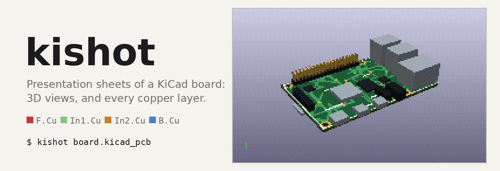
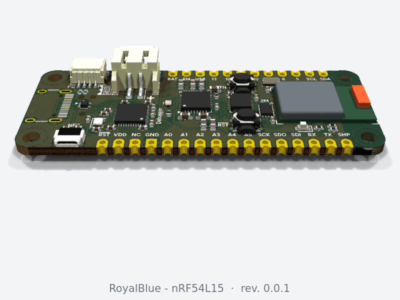
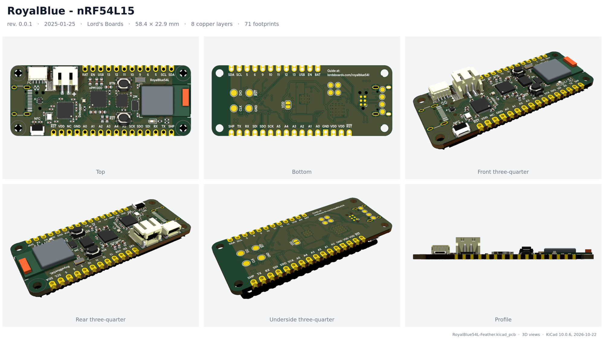
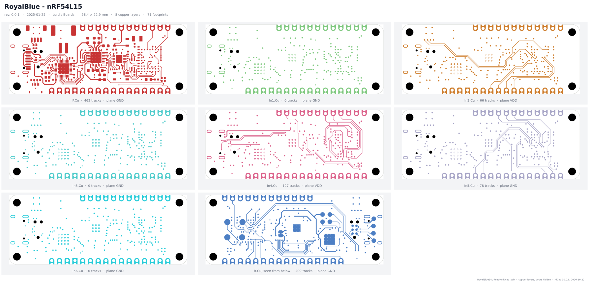
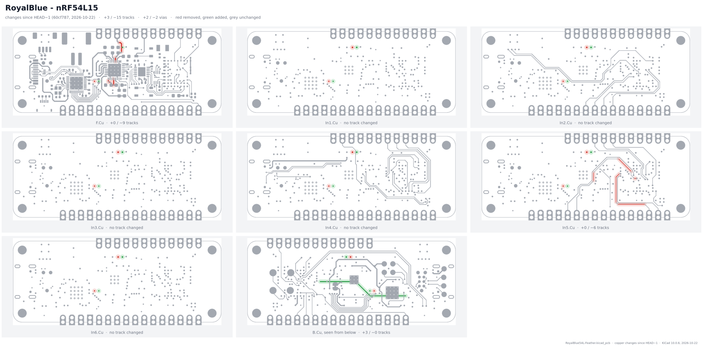
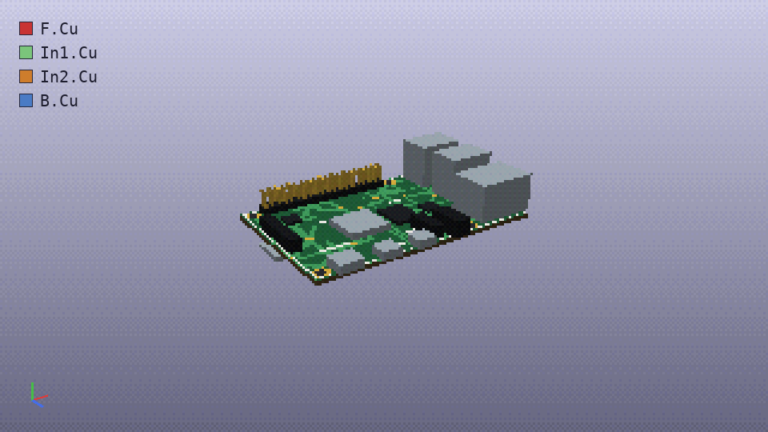

<p align="center">
  <picture>
    <source media="(prefers-color-scheme: dark)" srcset="docs/images/banner-dark.gif">
    
  </picture>
</p>

<p align="center">
  <a href="https://github.com/marc-alexis-com/kishot/actions/workflows/ci.yml"></a>
  <a href="LICENSE"></a>
  
  
</p>

**`kishot`** turns a KiCad board into sheets you can send: one PNG of six 3D views, one PNG
of the tracks on every copper layer, each under a header that says what the board is. One
command, no GUI, the same picture every time. It is a single Python file that drives
`kicad-cli` and ImageMagick.

```sh
kishot my-board.kicad_pcb
```

## Features

| Sheet | What you get |
|---|---|
| **3D** | top, bottom, three three-quarter views and the profile, in the colours of the PCB editor (solder mask included), cut out on a light background |
| **Copper layers** | every copper layer on its own, front to back, with the copper pours hidden so the routing shows; each one captioned with its track count and the net of its plane |
| **Changes** | `--diff REV`: every copper layer against the board at an older git revision, removed copper in red, added in green, the rest in grey, each change ringed so a short track still shows; tracks and vias added and removed, per layer and in total |
| **Turntable** | `-s spin`: an animated GIF of the board, rendered by KiCad, turning once on itself; chat apps play it inline |
| **Header** | title, revision, date and company from the title block (the schematic's, when the board's is empty), board size, copper layers, footprints; the file name and KiCad version in the footer |
| **For scripts** | stdout carries the paths written, one per line, and nothing else; progress and errors go to stderr; the exit status says whether every sheet was made |
| **Opening** | `--open` shows the images once written; under Hyprland, `--workspace N` puts them on another workspace without leaving yours, and replaces an older window of the same image |

## A look at it

<p align="center">
  
  <br><sub><code>kishot -s spin</code>: the board turning, as a GIF that Slack, Discord or a README play inline.</sub>
</p>

<p align="center">
  
  <br><sub>The 3D sheet: six views of the board, in the PCB editor's colours, under its title block.</sub>
</p>

<p align="center">
  
  <br><sub>The copper-layer sheet of the same board, eight layers. With the pours shown, most of
  these would be a solid rectangle of copper: here, the planes are named in the caption and the
  tracks are left to see. The bottom layer is mirrored, as seen from below.</sub>
</p>

<p align="center">
  
  <br><sub><code>kishot --diff HEAD~1</code>: what changed in the copper since the previous commit. Two
  vias moved (on every layer they go through), tracks removed on F.Cu and In5.Cu, a new path on B.Cu.</sub>
</p>

These sheets were made by `kishot` from the RoyalBlue54L Feather, a demo project that
ships with KiCad (see [Legal](#legal)), with no option.

## Install

Requirements: **KiCad 9 or later** (for `kicad-cli pcb render`; tested on 10.0.6 and 10.0.7),
**ImageMagick 7** (`magick`), Python 3.9 or later. `fc-match` (fontconfig) is used to find DejaVu Sans when it is there.

**Nix** (flake; ImageMagick included, and KiCad too if you have none):

```sh
nix run github:marc-alexis-com/kishot -- my-board.kicad_pcb
nix profile install github:marc-alexis-com/kishot
```

**pipx** or **pip**:

```sh
pipx install git+https://github.com/marc-alexis-com/kishot
```

**Just the file**: `kishot.py` has no dependency outside the standard library.

```sh
curl -Lo ~/.local/bin/kishot https://raw.githubusercontent.com/marc-alexis-com/kishot/main/kishot.py
chmod +x ~/.local/bin/kishot
```

## Usage

```sh
kishot                              # every sheet of the only board in this directory
kishot hw/my-board.kicad_pcb        # a given board
kishot hw/ -s layers                # only the copper layers
kishot -s 3d --fast                 # quick 3D preview
kishot -o out/                      # write somewhere else
kishot --open                       # open the images once written
kishot --open --workspace 11        # Hyprland: on workspace 11, in the background
kishot --diff HEAD~1                # what changed in the copper since the last commit
kishot --diff v1.0 -s all           # every sheet, the diff against tag v1.0
kishot -s spin                      # an animated GIF of the board turning
```

```text
usage: kishot [-h] [-s {3d,layers,diff,spin,all}] [-d REV] [-o DIR] [-f] [--open]
              [--workspace N] [--viewer CMD] [-V]
              [board]

positional arguments:
  board                 a .kicad_pcb file, or a directory holding exactly one
                        (default: .)

options:
  -s, --sheet {3d,layers,diff,spin,all}
                        sheet to make, repeatable: 3d, layers, diff, spin, all
                        (default: 3d and layers, or diff alone with --diff)
  -d, --diff REV        compare the copper with the board at this git revision
                        (a commit, tag, branch, HEAD~1...)
  -o, --out-dir DIR     where to write the images (created if missing)
  -f, --fast            basic 3D quality and smaller images, for a preview
  --open                open the images once written
  --workspace N         with --open under Hyprland: show them with swayimg on
                        workspace N, without switching to it, replacing an
                        older window of the same image
  --viewer CMD          with --open: the viewer command (default: swayimg, else
                        xdg-open)
```

The images are `<board>-3d.png`, `<board>-layers.png`, `<board>-diff.png` and
`<board>-spin.gif`. Without `--out-dir`, they go to a
`fabrication/` or `fab/` directory next to the board if there is one, else next to the board.
`KISHOT_WORKSPACE` and `KISHOT_VIEWER` set the defaults of the last two options.

Timings, on a laptop (Ryzen AI 7 PRO 350, 8 cores) for the 8-layer board above: about 50 s for
both sheets, 5 s with `--fast`; the spin about two minutes (36 frames, floor and shadows), 10 s
with `--fast` (24 frames). Nearly all of it is KiCad's ray tracer.

## For scripts

`kishot` is meant to be called by other programs as much as by people:

- **stdout** is the list of images written, one absolute path per line, printed as each sheet
  is done. Nothing else is ever printed there.
- **stderr** carries progress (`kishot: 3d sheet of board.kicad_pcb…`) and errors, one line
  each, without a traceback.
- **Exit status**: `0` when every sheet asked for was written, `1` on any failure (no board,
  `kicad-cli` missing or failing, ImageMagick missing), `2` on a usage error.
- No prompt, no window unless `--open` is passed.

```sh
kishot -s layers --fast | while read -r png; do upload "$png"; done
```

## How it works

**3D sheet.** Six `kicad-cli pcb render` runs in parallel, with the `follow_pcb_editor` preset:
the default preset follows the plot settings, which hide the solder mask, and the board would
come out as bare copper. Each render is cut out along its alpha channel and centred on a tile.
When a part sticks out of the frame (a cable, a long connector, a tall capacitor), the view is
rendered again further out, up to twice, and a warning says so if it is still cut.

<p align="center">
  
  <br><sub>What the copper-layer sheet shows: the board without its body and pours, one layer at a time.</sub>
</p>

**Copper-layer sheet.** On a board with a ground plane, the 3D view shows copper everywhere
under the mask, and the routing cannot be seen. `kishot` writes a copy of the board without the
zones' fill (every `filled_polygon` block; the zone outlines stay), then exports each copper
layer with its board outline to SVG (`kicad-cli pcb export svg --mode-single`), the back layer
mirrored, and rasterises it. Silkscreen and fabrication layers are left out on purpose: their
text hides the tracks. A pour counts as a plane, and is named in the caption, when its outline
covers at least 30 % of the board.

**Spin.** 36 renders (24 with `--fast`), the board tilted and turned by 10° each time. Every
frame is checked against the edges, as for the 3D sheet, since a part can leave the frame at one
angle only. All frames are cut to the same box, the union of what they show, so the board turns
in place instead of being re-centred at each frame, and share one palette, so the colours do not
flicker. About 3 MB in high quality, under 1 MB with `--fast`.

**Diff sheet.** `git show REV:<board>` gives the older board. Both versions lose their pour
fill, each copper layer is exported from both in black and white, and both SVGs are framed on
the same box, the union of the two outlines, in the board's own millimetres: an outline that
grew between the two still lines up. A pixel is grey when it is copper in both, red when only
in the old one, green when only in the new one, and anything that changed gets a pale halo.
The counts compare tracks and vias by their geometry (ends, width, size), not by their ids, so
a track that did not move is the same track even when KiCad renumbered it. A layer that exists
in only one version is shown entirely red or green.

The board file is read by a small S-expression scanner (quoted strings included), not by
regular expressions over the whole file, so the formatting of the file does not matter.

## Troubleshooting

| Symptom | Likely cause |
|---|---|
| The board comes out orange (bare copper) in 3D | The solder mask is hidden in the PCB editor's 3D viewer settings: `kishot` uses that preset (`follow_pcb_editor`). |
| A part is missing in 3D (a bare footprint, a hole) | The footprint has no 3D model, or KiCad cannot find it: check `KICAD9_3DMODEL_DIR` / `KICAD10_3DMODEL_DIR`. `kishot` renders what KiCad renders. |
| `view … still touches the frame` | Something very large sticks out of the board. The sheet is still made; that view is cut. |
| `rendering view 1 failed` | The output of `kicad-cli` follows the message. A KiCad older than 9 has no `pcb render`. |
| A plane's tracks still look solid | The zone is not a pour but a thick track or a pad. Only zone fills are hidden. |
| `reading board.kicad_pcb at REV failed` | git's own message follows: an unknown revision, or a board that did not exist yet at that revision (or had another name). |
| The whole diff is red and green, shifted | The board was moved on the page between the two versions; the diff compares page coordinates. |
| `--workspace needs Hyprland, hyprctl and swayimg` | Outside Hyprland, `--workspace` is ignored and the images open the usual way. |

## Development

```sh
nix develop                                   # optional: Python (numpy, Pillow), ImageMagick, fontconfig
python3 -m unittest discover -s tests -v      # parser, layer order, planes, command line
nix flake check                               # the same tests, in the Nix sandbox
python3 docs/images/render.py docs/images     # the README's animations (numpy, Pillow)
```

The tests need neither KiCad nor ImageMagick. The whole tool is `kishot.py`:

| Part | Role |
|---|---|
| reading the board | S-expression scanner, title block, outline, copper layers, tracks, planes, fill stripping |
| drawing | the calls to `kicad-cli` and `magick`, tiles, grid, header and footer |
| opening | the viewer, and the Hyprland path (Lua or classic configuration) |
| command line | arguments, output directory, exit status |

## Contributing

Issues and pull requests are welcome, especially a board that comes out wrong. The most useful
report says the KiCad version (`kicad-cli --version`), the ImageMagick version, and, when the
board is public, a link to it. Please keep pull requests to the standard library.

## Legal

The animated pictures are generated by [docs/images/render.py](docs/images/render.py), a small
software renderer in the manner of a PS2 game: a low-poly board built from boxes after the
proportions of a Raspberry Pi 4, its tracks drawn at random, in KiCad's default colours. It
uses no Raspberry Pi design file; "Raspberry Pi" is a trademark of Raspberry Pi Ltd.

The two sheets in this README (`3d.png`, `layers.png`) show the **RoyalBlue54L Feather** by Lord's Boards
([project](https://www.crowdsupply.com/lords-boards/royalblue54l-feather)), released under the
CERN Open Hardware Licence v2, Permissive, and shipped with KiCad as a demo project. They were
rendered by `kishot` from that project, unchanged, except the diff sheet: it compares the
project with a copy in which a few tracks were removed, two vias moved and one path added, for
the example. This project is not affiliated with KiCad
or with Lord's Boards; "KiCad" is used here only to name the software it works with.

## License

[MIT](LICENSE)
